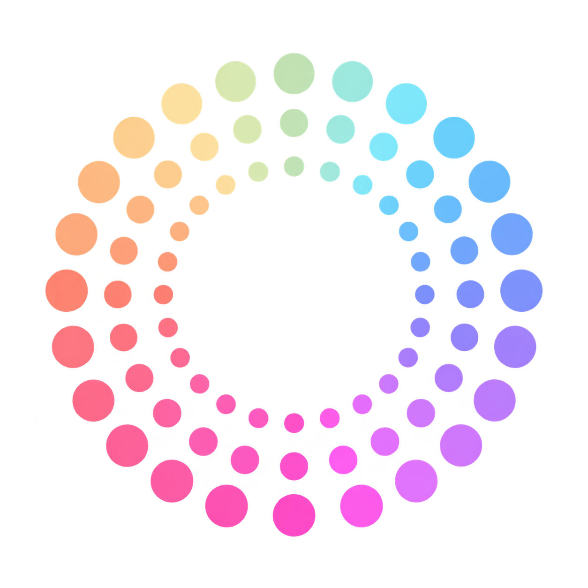

<p align="center"></p>

# Nute Notes

**Ваши заметки. Ваш сервер. Ваш контроль.**

Бесплатная альтернатива Заметкам Apple для тех, кто хочет хранить личные записи на собственном сервере. Пишите в браузере или приложении, редактируйте без сети в установленном клиенте и синхронизируйте устройства через свой экземпляр Nute Notes.

[English](README.en.md) · [Установка сервера](docs/INSTALL.md) · [Руководство](docs/USER-GUIDE.md) · [Настольные приложения](docs/DESKTOP.md) · [Android](docs/ANDROID.md) · [Безопасность](SECURITY.md)

## Что умеет

- Заметки и папки, поиск, закрепление, корзина.
- Форматирование текста, заголовки, списки, чек-листы и таблицы.
- Автосохранение, синхронизация правок и удалений; сохранение конфликтующих версий.
- Зашифрованная локальная очередь для офлайн-работы установленных клиентов.
- Шифрование содержимого на клиенте, двухфакторный вход TOTP, резервные коды и доверие устройству на **180 дней**.
- Четырёхзначный PIN для отдельной заметки; зашифрованный экспорт и импорт.
- Исходники клиентов для Windows, Ubuntu и Android.

**Один экземпляр — один владелец.** Это личное хранилище, а не многопользовательский сервис. Для другого человека установите отдельный экземпляр с новой базой и ключами. Публичной регистрации, совместного редактирования, вложений и iOS-клиента в этом выпуске нет.

## Свой сервер

Нужны новый VPS с Ubuntu 24.04/26.04, systemd, root-доступ, домен и доступные извне TCP 80/443. Рекомендуется от 2 ГБ RAM. Установщик разворачивает Nginx, PHP-FPM, MySQL, HTTPS и локальное резервное копирование.

На **чистом VPS**, после настройки DNS:

```bash
sudo apt update
sudo apt install git
git clone https://github.com/mrnuked/nute-notes.git
cd nute-notes
sudo bash installer/install.sh --domain notes.example.org --email admin@example.org --check
sudo bash installer/install.sh --domain notes.example.org --email admin@example.org
```

Замените домен и email своими. Затем получите одноразовый токен командой `sudo cat /srv/nute/private/first-owner.txt`, откройте `https://notes.example.org/?setup` и создайте владельца.

До запуска прочитайте [полную инструкцию](docs/INSTALL.md): скрипт рассчитан на новую установку и отказывается перезаписывать существующие данные. Это не обновление и не миграция.

## Приложения и состояние выпуска

В [выпуске 0.5.0](https://github.com/mrnuked/nute-notes/releases/tag/v0.5.0) доступны серверный архив и установочный `.deb` для Ubuntu x86-64. Для Windows и Android опубликованы исходники; готовых EXE/APK в этом выпуске нет. Инструкции сборки: [Windows и Ubuntu](docs/DESKTOP.md), [Android](docs/ANDROID.md).

Ubuntu-пакет собран, установлен и проверен в Ubuntu 24.04 внутри WSL с Xvfb и GNOME Keyring, включая запуск и фоновую отправку после закрытия окна. Полный рабочий стол GNOME, Wayland и Ubuntu 26.04 отдельно не проверялись. Android прошёл debug-сборку и модульные тесты без проверки на физическом устройстве; новый Windows-установщик не собирался.

Настольные клиенты предлагают адрес вашего HTTPS-сервера и разделяют локальные профили разных доменов. Android собирается под выбранный адрес. Веб-интерфейс работает на домене установленного сервера.

## Что означает «под своим контролем»

Вы управляете сервером, доменом, копиями и обновлениями. MIT разрешает бесплатно использовать, изменять и распространять код, включая коммерческое использование, с сохранением лицензии.

Шифрование не даёт абсолютной защиты: взломанный веб-сервер может подменить JavaScript, слабый мастер-пароль можно подбирать по украденным данным, а открытое приложение доступно тому, кто получил ваше устройство. Автоблокировки по простою нет. PIN из четырёх цифр не превращает заметки в менеджер паролей. Подробности и границы защиты — в [SECURITY.md](SECURITY.md).

## Разработка

Нужны Node.js 24, npm и PHP 8.3+ с PDO SQLite для локальных тестов:

```bash
npm ci
npm test
npm run test:http
npm run build
npm run dev
```

Локальный адрес — `http://127.0.0.1:4173`, первоначальный токен сохраняется в `private/local-setup-token.txt`. Используйте тестовый аккаунт и тестовые записи. Каталог `private/` нельзя публиковать или включать в архивы.

[Как внести вклад](CONTRIBUTING.md) · [Лицензия MIT](LICENSE) · [Сторонние компоненты](THIRD_PARTY_NOTICES.md)

Nute Notes — независимый проект, не связанный с Apple и не одобренный ею. Apple Notes / «Заметки Apple» упоминаются для описания назначения; совпадение функций и совместимость с iCloud не обещаются.
